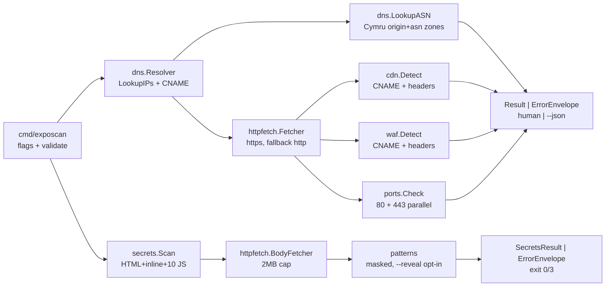

# Architecture

Minimal flow for `exposcan` v1 plus `--secrets` mode (see `docs/adr/`).

`internal/exposcan.Scan` orchestrates with injected `Deps{DNS, HTTP, Dial}`
under a 15s global context. Partial results carry `HTTPError` warnings;
only DNS failure or context expiry returns an error.

`internal/secrets.Scan` (separate `--secrets` mode) fetches HTML (https with
fallback to http only on transport failure), scans the HTML plus inline
scripts, then up to 10 external `.js` same-origin-first under the same
global context. Single `.js` failures are skipped; HTML failure or context
expiry returns an error. Exit `3` means findings, `0` means clean.
