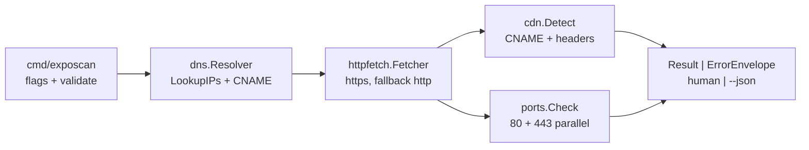

# Architecture

Minimal flow for `exposcan` v1 (see `docs/adr/` for decisions).

`internal/exposcan.Scan` orchestrates with injected `Deps{DNS, HTTP, Dial}`
under a 15s global context. Partial results carry `HTTPError` warnings;
only DNS failure or context expiry returns an error.
